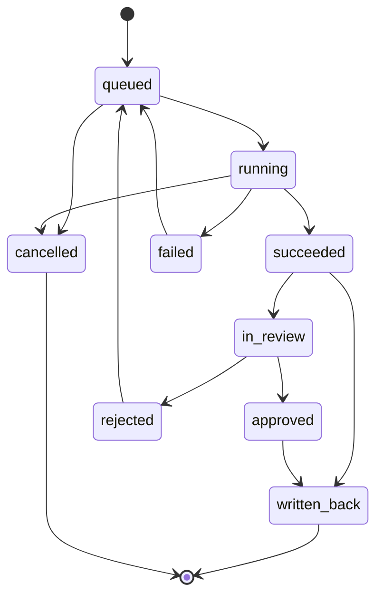

# S5-SAI-001 · 招商 AI 任务表与输出版本表（模型与迁移）

本仓库交付「会员空间平台」Stage V · 招商 AI 模块的落库基础：`sai_task`（AI 任务）与
`sai_output`（输出版本）两张表、Alembic 迁移（含 `downgrade`）、任务状态机工具函数、
单元测试与本文档。按项目统一技术约定，后端使用 Python 3.11+ / SQLAlchemy 2 / Alembic /
PostgreSQL 16；代码中没有引入任何向境外发送数据的第三方 SDK。

> 数据口径：本仓库全部使用虚构 UUID 与虚构文本，不含任何真实个人信息或企业信息，
> 不出现客户名称。`subject_id`、`review_item_id` 等外部对象在本工单中仅以 UUID 保存。

## 1. 目录

```text
app/
  db.py                              # Declarative Base；DATABASE_URL 只读环境变量
  modules/sai/
    enums.py                         # 5 组枚举值（与迁移中的字面量一致）
    idempotency.py                   # 白名单字段规范化 + input_hash 计算
    state_machine.py                 # 合法边表、InvalidTransition、transition()
    versions.py                      # 输出版本号分配（每次人工编辑 +1）
    models/
      base.py                        # id/org/site/时间戳/软删除 列约定
      sai_task.py                    # sai_task 模型与约束
      sai_output.py                  # sai_output 模型与约束
migrations/
  env.py
  versions/0001_sai_tables.py        # 建表 + 枚举类型 + 索引；含 downgrade
tests/
  test_migration_roundtrip.py        # AC1：迁移往返、结构、枚举域、零漂移
  test_state_machine.py              # AC2：全部合法边 + 全部非法边
  test_task_unique.py                # AC3：部分唯一索引幂等
  test_models.py                     # 默认值、CHECK 约束、输出版本
  test_idempotency.py                # input_hash 规范化稳定性
scripts/
  migration-check.sh                 # upgrade -> downgrade -1 -> upgrade -> check
  test.sh                            # pytest + 证据收集
docs/er.mmd                          # ER 图（Mermaid）
docker-compose.test.yml              # PostgreSQL 16（pgvector/pg16）
evidence/                            # 本机 PG16 实测输出
```

## 2. 运行

### 2.1 安装依赖

```bash
python3.12 -m venv .venv          # 3.11 及以上均可
.venv/bin/pip install -r requirements.txt
```

### 2.2 起一个 PostgreSQL 16

任选其一：

```bash
# A. 容器（映射到 127.0.0.1:55439）
docker compose -f docker-compose.test.yml up -d postgres

# B. 已有 PG16 实例
createdb -h 127.0.0.1 -p 5432 -U <user> clawhunt_1834_test
```

连接串只从环境变量读取（没有本机默认库回退）：

```bash
export DATABASE_URL="postgresql+psycopg://clawhunt@127.0.0.1:55439/clawhunt_1834_test"
export TEST_DATABASE_URL="$DATABASE_URL"
```

### 2.3 迁移与验收

```bash
.venv/bin/alembic upgrade head        # 建表
.venv/bin/alembic downgrade -1         # 回滚本迁移（单 revision，等价 base）
.venv/bin/alembic upgrade head
.venv/bin/alembic check                # 期望：No new upgrade operations detected.
./scripts/migration-check.sh           # 以上四步的封装，输出即 evidence
```

### 2.4 测试

```bash
.venv/bin/pytest -q
# 或
./scripts/test.sh
```

`TEST_DATABASE_URL` 的库名必须包含 `test`：测试 fixture 会 `DROP SCHEMA public CASCADE`
并重建，禁止指向共享库。

## 3. 表结构

### 3.1 `sai_task`

| 字段 | 类型 | 空 | 默认 | 说明 |
|---|---|---|---|---|
| `id` | UUID | N | `gen_random_uuid()` | 主键 |
| `org_id` / `site_id` | UUID | N | — | 租户与站点 |
| `task_type` | `sai_task_type` | N | — | `lead_enrich` / `lead_assess` / `lead_dedup` / `lead_assign` / `visit_minutes` / `quote_draft` / `proposal_draft` |
| `subject_type` | `sai_subject_type` | N | — | `lead` / `visit` / `quote` / `proposal` |
| `subject_id` | UUID | N | — | 业务对象 ID；对象属其他模块，本表不建外键 |
| `status` | `sai_task_status` | N | `queued` | 9 状态；合法流转见第 4 节 |
| `prompt_key` | varchar(128) | Y | — | Prompt 注册表键，如 `sai.lead_enrich` |
| `prompt_version` | varchar(64) | Y | — | 固定到具体版本，保证可复现 |
| `model_name` | varchar(128) | Y | — | 模型标识；确定性任务（如 `lead_dedup`）可为空 |
| `input_hash` | varchar(64) | N | — | 规范化输入的 SHA-256 小写十六进制 |
| `review_level` | `sai_review_level` | N | `L1` | `L1` / `L2` / `L3` |
| `review_item_id` | UUID | Y | — | 审核队列项；审核模块属其他工单，先留空/桩 |
| `error_code` | varchar(64) | Y | — | 稳定的机器可读错误码 |
| `tokens_in` / `tokens_out` | integer | N | `0` | 运行期上报的 token 数 |
| `latency_ms` | integer | Y | — | 端到端耗时（毫秒） |
| `attempts` | integer | N | `0` | 执行次数，重试递增 |
| `created_at` | timestamptz | N | `now()` | 创建时间 |
| `created_by` | UUID | Y | — | 创建人 |
| `updated_at` | timestamptz | N | `now()` | 更新时间（ORM `onupdate`） |
| `deleted_at` | timestamptz | Y | — | 软删除时间 |

约束与索引：

- `uq_sai_task_id_tenant`：`UNIQUE (id, org_id, site_id)`，作为 `sai_output` 复合外键的父键。
- `uq_sai_task_idempotency`：**部分唯一索引** `(org_id, task_type, subject_id, input_hash)`
  `WHERE deleted_at IS NULL`。存活任务同四元组只允许一行；软删除后可重跑。
- `ck_sai_task_input_hash_sha256`：`input_hash ~ '^[0-9a-f]{64}$'`。
- `ck_sai_task_prompt_pair`：`(prompt_key IS NULL) = (prompt_version IS NULL)`。
- `ck_sai_task_tokens_in_non_negative` / `..._tokens_out_...` / `..._latency_...` /
  `..._attempts_...`：计数与耗时不得为负。
- 普通索引：`ix_sai_task_tenant_status`、`ix_sai_task_subject`、
  `ix_sai_task_review_item`（`review_item_id IS NOT NULL` 的部分索引）。

### 3.2 `sai_output`

| 字段 | 类型 | 空 | 说明 |
|---|---|---|---|
| `id` | UUID | N | 主键 |
| `org_id` / `site_id` | UUID | N | 租户与站点，必须与所属任务一致 |
| `task_id` | UUID | N | 所属任务 |
| `version` | integer | N | 首个模型输出为 1；每次人工编辑 +1；不得小于 1 |
| `output_json` | jsonb | N | 结构化草稿；只允许 object 或 array |
| `schema_version` | varchar(64) | N | 输出 JSON Schema 版本，如 `sai.quote_draft.v1` |
| `source` | `sai_output_source` | N | `ai` / `human_edit` |
| `edited_by` | UUID | Y | 人工编辑者；`ai` 行为空，`human_edit` 行必填 |
| `created_at` / `created_by` / `updated_at` / `deleted_at` | — | — | 同统一约定 |

约束与索引：

- `fk_sai_output_task_tenant`：`(task_id, org_id, site_id) -> sai_task(id, org_id, site_id)`，
  `ON DELETE CASCADE`；跨租户挂输出会被拒绝。
- `uq_sai_output_task_version`：部分唯一索引 `(task_id, version) WHERE deleted_at IS NULL`，
  防止并发编辑覆盖历史；软删除后的版本可重新使用（审计行保留）。
- `ck_sai_output_version_positive`、`ck_sai_output_output_json_document`、
  `ck_sai_output_source_edited_by`（`ai` 行 `edited_by` 必须为空，`human_edit` 行必须非空）。

### 3.3 幂等键 `input_hash`

`app/modules/sai/idempotency.py` 提供 `compute_input_hash(payload, fields=(...))`：
只在白名单字段上计算，JSON 键排序、紧凑分隔符、UTF-8；缺失字段与显式 `null` 等价，
`request_id`、接收时间等传输字段不参与。返回值固定为 64 位小写 SHA-256，
直接写入 `sai_task.input_hash`，与 `uq_sai_task_idempotency` 配合实现重试幂等。

## 4. 状态机

合法边共 **12** 条；未列出的任意流转（包括自流转）一律抛出 `InvalidTransition`。
`written_back` 与 `cancelled` 为终态。

| From | To | 场景 |
|---|---|---|
| `queued` | `running` | worker 取到任务开始执行 |
| `queued` | `cancelled` | 入队后撤销 |
| `running` | `succeeded` | 模型执行成功，产出首版输出 |
| `running` | `failed` | 执行失败，记录 `error_code` |
| `running` | `cancelled` | 执行中撤销 |
| `failed` | `queued` | 失败重试（`attempts` 递增） |
| `succeeded` | `in_review` | 进入人工审核（按 `review_level`） |
| `succeeded` | `written_back` | 免审任务直接回写 |
| `in_review` | `approved` | 审核通过 |
| `in_review` | `rejected` | 审核驳回 |
| `rejected` | `queued` | 按意见返工 |
| `approved` | `written_back` | 审核通过后回写业务对象 |



使用方式（应用层唯一入口，调用方负责事务提交）：

```python
from app.modules.sai.state_machine import transition

transition(task, "running")        # 合法，task.status 变为 running
transition(task, "approved")       # 非法：抛 InvalidTransition，task 保持不变
```

`SaiTask.status` 还挂了 ORM 层的 `@validates` 守卫：绕过 `transition()` 直接赋值同样走
同一张边表并抛 `InvalidTransition`，只有新建任务时的初始状态可以自由设定。守卫通过
ORM 属性读取旧状态，因此默认 `expire_on_commit=True` 导致属性过期时，会先惰性加载
已落库的状态再判定；脱离 Session 且已过期的实例无法取回旧状态，赋值直接拒绝。

约束分工：数据库的 `sai_task_status` 枚举负责值域；流转矩阵由
`app/modules/sai/state_machine.py` 的 `ALLOWED_TRANSITIONS` 统一维护。没有用触发器实现，
原因是 `CHECK` 无法表达矩阵、触发器会把业务规则藏进迁移并对批量回放不友好；所有写状态
的服务（worker、审核、回写）共用这一个表，规则只需改一处。

## 5. 验收映射

| 验收标准 | 实现 | 验证 |
|---|---|---|
| AC1：`alembic upgrade head` 与 `downgrade -1` 在 PG16 成功，`alembic check` 无漂移 | `migrations/versions/0001_sai_tables.py`（枚举类型先建后删、部分索引、复合 FK） | `tests/test_migration_roundtrip.py::test_upgrade_downgrade_one_upgrade_and_zero_drift`；`scripts/migration-check.sh`；`evidence/02-migration-check.txt` |
| AC2：状态机测试覆盖全部合法边，至少 5 条非法流转抛 `InvalidTransition` | `app/modules/sai/state_machine.py`（12 条边的显式表 + 异常）；`SaiTask.status` 的 ORM `@validates` 守卫 | `tests/test_state_machine.py`：12 条合法边逐条参数化；69 条非法边全量断言；9 条代表性非法边；直接赋值拦截；`expire_on_commit=True` 过期后仍拦截 |
| AC3：同 `(org_id, task_type, subject_id, input_hash)` 的未删除记录重复插入被唯一索引拒绝 | `uq_sai_task_idempotency`（`WHERE deleted_at IS NULL`） | `tests/test_task_unique.py`：断言冲突约束名为该索引；软删后可重跑；跨 org/hash/subject/task_type 允许 |

实测（PostgreSQL 16.16，Python 3.12.12）：

```text
100 passed
alembic check: No new upgrade operations detected.
```

`evidence/03-pytest.log` 为提交前的真实输出。

## 6. 对接点与未含范围

- `subject_id`：指向 lead / visit / quote / proposal，对象由其他工单维护；本工单只存 UUID，
  不建外键，跨模块一致性由对象所属模块负责。
- `review_item_id`：审核队列项；审核模块尚未交付时留空或写入桩 UUID。
- `prompt_key` / `prompt_version`：Prompt 注册表由其他工单提供；本工单只记录键与版本。
- `model_name`、`tokens_in/out`、`latency_ms`：由模型网关/worker 回填；本工单不调用模型。
- 不含：worker、任务调度、Prompt 注册表实现、模型网关、审核队列、回写业务对象、
  对外 API。以上均以接口桩/mock 处理，对接点即上述字段。
- 修改边界：验收后含 1 轮针对本工单范围的修改；新增业务表或改状态边表属于范围变更。

## 7. 环境与合规

- 依赖：SQLAlchemy 2、Alembic、psycopg 3、pytest（见 `requirements.txt`），全部为开源库，
  不向境外发送数据。
- 配置与密钥只从环境变量读取；仓库内不含任何密钥。
- 数据库：PostgreSQL 16（本机实测 16.16；`docker-compose.test.yml` 使用 `pgvector/pgvector:pg16`，
  与本项目 PG16 + pgvector 的约定一致；本工单的两张表不使用向量扩展）。
